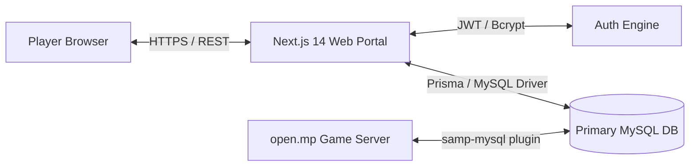

# Los Jawa Roleplay — Comprehensive Systems & Feature Architecture

This document provides an in-depth technical breakdown of the gameplay systems, domain architecture, and engineering design implemented in the **Los Jawa Roleplay** open.mp (SA-MP) gamemode and accompanying Next.js Web Portal.

---

## Architecture Overview

The gamemode source is engineered using a **modular Pawn architecture** (`gamemodes/modules/`), decoupling concerns across domain modules, persistent data stores, and event hooks:

```
gamemodes/
├── roleplay.pwn                 # Core initialization, gamemode callbacks & tick routing
└── modules/
    ├── player/                  # Authentication, persistent player state, login UI
    ├── system/                  # World simulation, public transit, agricultural cycles
    ├── vehicle/                 # Physics, modular damage, custom sirens (ELM), modding
    ├── police/                  # Surveillance, citations, tactical law enforcement
    ├── Business.pwn             # Commercial establishments & profit pools
    ├── Property.pwn             # Dynamic real estate, virtual worlds & keys
    ├── Furniture.pwn            # Real-time 3D furniture customization engine
    ├── Industry.pwn             # Industrial supply chains & refining pipelines
    ├── Store.pwn                # Retail distribution & inventory stocking
    ├── MobileDataComputer.pwn   # In-game police terminal & database lookup (215 KB)
    ├── Faction.pwn              # Faction RBAC, duty statuses, static fleet
    ├── Prison.pwn               # Sentence processing, bail calculations & cells
    ├── Drugs.pwn                # Contraband synthesis, pharmacology & trafficking
    ├── IllegalWeapon.pwn        # Firearm component crafting & serial indexing
    ├── Graffiti.pwn             # In-game spray rendering & territory influence
    ├── Zones.pwn                # Gang turf boundaries & conquest state
    ├── TrainSystem.pwn          # Autonomous scheduled railway transit network
    ├── MapEditor.pwn            # In-game 3D world map editor with live review
    ├── MappingRequest.pwn       # Player mapping submission & approval pipeline
    ├── Anticheat.pwn            # Heuristic telemetry & anti-tamper defenses
    ├── Phone.pwn                # Interactive smartphone, SMS & telephony routing
    ├── HudV2.pwn                # Modern vector-style TextDraw HUD
    └── Queries.pwn              # In-game SQL query execution & diagnostic engine
```

All game data is asynchronously committed and queried against **MySQL 5.7** using connection pooling and prepared statements (`samp-mysql` plugin). Real-time telemetry, user management, and email workflows synchronize with the **Next.js 14 App Router** web portal.

---

## 1. Macro Economy & Real Estate Engine

### Dynamic Real Estate & Property Instances (`Property.pwn`)
- **Complex Hierarchies:** Supports standalone houses, residential estates, and complex multi-unit apartment complexes.
- **Interior Virtual Worlds:** Utilizes SA-MP virtual worlds and interior IDs to dynamically allocate and isolate player living spaces without collision conflicts.
- **Key & Access Delegation:** Players can assign sub-keys to housemates, set access passwords, configure lock states, and collect tenant rent.
- **Persistent Data Storage:** Coordinates, interior layouts, safe contents, lock status, and purchase prices are stored in MySQL (`property_mappings`).

### Real-Time 3D Furniture Placement Engine (`Furniture.pwn`)
- **Interactive In-Game Editing:** Players can purchase and customize hundreds of interior furniture objects with full 6-axis 3D freedom (X, Y, Z coordinates, roll, pitch, and yaw rotation).
- **Raycast Object Manipulation:** Implements SA-MP object editing handles allowing precise repositioning and surface snapping.
- **Coordinate Serialization:** Object indices, models, spatial vectors, and material attachments serialize dynamically into MySQL records linked directly to the parent property ID.

### Industrial Supply Chains & Production Logistics (`Industry.pwn`, `Store.pwn`, `Business.pwn`)
- **Multi-Tier Economic Pipeline:**
  1. **Raw Resource Extraction:** Agricultural produce, timber, or metal ore collected by players.
  2. **Industrial Processing:** Factories refine raw goods into consumer stock (e.g., flour into bread, metal into vehicle parts).
  3. **Logistical Hauling:** Truckers transport finished goods from manufacturing plants to retail stores across San Andreas.
  4. **Retail Distribution:** Stores (`Store.pwn`) consume stock to serve consumer purchases, dynamically adjusting prices based on stock levels.
- **Business Profit Pools:** Business owners manage employee payroll, customize item catalog markups, and withdraw accrued revenue directly through in-game management dialogs.

### Agricultural & Farming Cycle (`Farmer.pwn`, `HarvesterRental.pwn`)
- **Plant Growth Timers:** Farmland zones track crop maturity states across scheduled server timers.
- **Machinery Leasing:** Players lease specialized combine harvesters via `HarvesterRental.pwn`, calculating lease fees, operational wear, and harvest volume yield.

---

## 2. Tactical Law Enforcement Operations

### Mobile Data Computer (MDC) (`MobileDataComputer.pwn` — 215 KB)
A fully interactive in-game police terminal rendered entirely through interactive TextDraws, accessible from law enforcement vehicles and headquarters:
- **Citizen Database Search:** Query citizen records by name or National ID, displaying driving licenses, weapon permits, registered addresses, and historical arrest records.
- **Vehicle Registry Lookup:** Search license plates to inspect vehicle registration status, registered owners, reported stolen flags, and outstanding traffic tickets.
- **Warrants & APB Broadcasts:** Issue active arrest warrants and city-wide All-Points Bulletins (APB) that notify all online law enforcement units.
- **Citation & Ticketing System:** Direct integration with `Fines.pwn`, instantly logging traffic or criminal citations and debiting or pending against the offender's bank balance.

### Real-Time CCTV Surveillance Network (`CCTV.pwn`)
- **Camera Network:** Strategically deployed surveillance cameras across high-crime junctions, banks, and government facilities.
- **Live Stream Interpolation:** Law enforcement officers can access camera consoles, interpolating the player's spectator camera to fixed camera vectors with pan, zoom, and tilt controls.

### Faction Management & Static Vehicle Fleet (`Faction.pwn`, `FactionStaticVeh.pwn`)
- **Role-Based Access Control (RBAC):** Granular permission ranks, duty toggling (`/duty`), specialized gear distribution, and encrypted departmental radio frequencies.
- **Static Fleet Engine:** Pre-configured emergency and faction vehicles persist in designated station bays, auto-respawning with predefined liveries, fuel capacities, and siren configurations.

### Penal & Correctional Engine (`Prison.pwn`)
- **Automated Cell Routing:** Automatically calculates sentences, routes inmates to secure correctional cells, and updates jail timers in the database to prevent avoidance via disconnection.
- **Bail Calculations:** Configurable bail amounts processed through bail bond transactions, freeing eligible suspects while recording legal outcomes.

---

## 3. Underworld & Contraband Operations

### Contraband Synthesis & Trafficking (`Drugs.pwn`, `DrugStore.pwn`)
- **Chemical Processing:** Players acquire precursors, craft compounds at clandestine laboratory locations, and synthesize distinct drug variants (Cannabis, Methamphetamine, Cocaine).
- **Pharmacological Effects:** Consuming substances triggers transient character stat boosts (temporary health buffers, stamina boosts, visual screen shaders) paired with withdrawal penalties and addiction levels.
- **Black Market Drug Stores:** Underground distribution networks allowing organized crime syndicates to wholesale bulk narcotics.

### Black Market Firearm Assembly (`IllegalWeapon.pwn`, `Weapons.pwn`)
- **Component Crafting:** Smuggled weapon frames, barrels, and receivers can be assembled into functioning firearms.
- **Serial Tracking & Ballistics:** Tracks weapon serial numbers, enabling law enforcement ballistic investigations on recovered guns.

### Turf Warfare & Dynamic World Graffiti (`Graffiti.pwn`, `Zones.pwn`)
- **In-Game Spray Mechanics:** Real-time spray can mechanics render custom gang tags onto building facades using dynamic world textdraws and objects.
- **Territory Influence:** Spraying tags inside faction turf boundaries increases gang influence, providing passive respect and revenue bonuses.

---

## 4. Living World Simulation & Transit Infrastructure

### Autonomous Railway Network (`TrainSystem.pwn` — 87 KB)
- **Automated Train Transit:** Autonomous passenger trains loop around the statewide railway network on calculated schedules.
- **Station Synchronizations:** Trains decelerate, stop, open passenger doors at designated rail stations (Market Station, Cranberry Station, etc.), allowing players to board and ride as a realistic public transit alternative.

### Modular Vehicle Damage, Parts & Tuning (`VehicleParts.pwn`, `Player.pwn`, `ELM.pwn`, `Modshop.pwn`)
- **Modular Component Degradation:** Tracks discrete health values for engines, transmissions, batteries, and tires.
- **Trunk & Glovebox Storage:** Players can store weapons, tools, and contraband inside vehicle trunks, persisting across server restarts.
- **Emergency Lights Mod (ELM):** Dynamic strobe and siren light sequences simulated via vehicle light toggles, replicating realistic multi-phase emergency flashes for police cruisers and ambulances.
- **Custom Modshop Engine:** Modshop integrations allowing players to customize rims, hydraulics, paint jobs, and nitro boosters.

### Ambient AI & NPC Ecosystem (`AiNpc.pwn`)
- Automated NPC agents positioned throughout the world for retail interactions, dynamic transit ticket dispensers, and immersive ambient life.

### In-Game Smartphone & Telephony (`Phone.pwn` — 100 KB)
- **TextDraw Smartphone UI:** Custom graphical smartphone on player screen.
- **Features:** Contact address book, real-time SMS messaging between online players, direct 911 emergency dispatch calls, bank transfers, and taxi service hailing.

---

## 5. Full-Stack Modern Web Portal & UCP (`web/`)

Built with **Next.js 14 (App Router)**, **TypeScript**, and **Tailwind CSS**, interfacing with the same MySQL database used by the open.mp game server.



- **Stateless JWT Authentication:** Secure session management via signed JSON Web Tokens (`JWT_SECRET`).
- **Synchronized Password Hashing:** Uses bcrypt password hashes compatible with the Pawn gamemode authentication routine, allowing seamless login between web and game client.
- **Automated Transactional Emails:** Nodemailer integration (`SMTP_*`) handles email verification on registration and secure token-based password reset links.
- **Live Character Telemetry:** Players inspect their in-game persona status, bank accounts, registered vehicles, property deeds, and faction ranks directly on the web dashboard.
- **Donator & Supporter Portal:** Web-based interface for managing supporter packages and unlocking perks.
- **Automated Server Status & Changelog:** Displays real-time server health, player counts, and update history.

---

## 6. Staff Live-Ops, Anticheat & Developer Tooling

### In-Game 3D Map Editor & Live Approval Pipeline (`MapEditor.pwn`, `MappingRequest.pwn`)
- **Live World Builder:** Administrators and approved mappers can spawn, transform, scale, and align 3D world objects in real time without recompiling or rebooting the server.
- **Mapping Request Workflow:** Players submit custom interior mapping requests in-game; administrators review, test, and merge approved submissions into the production world database dynamically.

### Heuristic Anticheat Defenses (`Anticheat.pwn`)
- Server-side heuristic monitoring detecting client tampering:
  - Movement speedhack and unnatural velocity detection.
  - Airbreak and illegal coordinate teleportation.
  - Client-side money or ammo spoofing.
  - Rapid-fire and illegal weapon spawning.

### In-Game SQL Diagnostic Suite (`Queries.pwn`, `AdminCommands.pwn` — 350 KB)
- Senior administrators and developers can execute diagnostic queries, inspect live table rows, reload configurations, and hot-fix player state bugs directly from the in-game console with audit logging.

---

## 7. Core Immersion & UI/UX

- **Modern Vector-Style HUD (`HudV2.pwn`):** Clean, minimalist on-screen indicators for health, armor, hunger, thirst, cash, and vehicle telemetry.
- **Dynamic Wardrobe & Accessory Attachment (`Clothing.pwn`):** Precise 3D bone attachment editor allowing players to wear and position glasses, hats, badges, and holsters with custom offset vectors.
- **Integrated Death & Medical Flow (`Death.pwn`):** Incapacitated states, emergency paramedic triage, revival mechanics, and death penalty processing.
